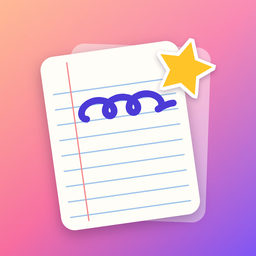

<p align="center"></p>

# MB Notes

**Marginally better notes.** MB Notes is a free, open-source, pencil-first note-taking app for iPad and iPhone, in the spirit of GoodNotes, with a Liquid Glass design and on-device intelligence. No account, no subscription, and your notes are plain folders you own.

## What it does

- **Handwriting first.** PencilKit ink on lined, dot, grid, Cornell, planner, music, isometric, and other papers. The Pencil draws and fingers scroll; finger drawing is one tap away. Type second with the text tool.
- **Shape snapping.** Draw a box, circle, triangle, star, or line and pause; it snaps clean.
- **Write on anything.** Import PDF, PowerPoint, Word, Excel, Keynote, Pages, OpenDocument (ODT, ODP, ODS), RTF, text, and images, then annotate.
- **Cute organization.** Folders with your own colors, SF Symbols, and stickers. Notebooks with covers and decorated title pages. Stickers and washi tape on pages. Eight app icons to choose from.
- **Lecture mode.** Record while you write. You get a live on-device transcript, speaker labels you can rename or hide ("Professor", "Student"), filler-word skipping, cleaned-up audio, and playback that shows what you were writing at each moment. Tap any stroke to hear what was being said.
- **Searchable everything.** Handwriting is recognized on device. Search covers titles, handwriting, typed text, imported slides, and transcripts. PDF exports carry an invisible text layer, so other apps can search them too.
- **Bring your own AI.** Summaries and Q&A with Apple Intelligence, a small Hugging Face model running on your device, or your own key for any OpenAI-compatible API. Presets cover OpenAI, OpenRouter, Anthropic, Gemini, Groq, Ollama, and more. AI is off until you choose.
- **Moddable.** Papers, covers, stickers, palettes, and folder icons all come from `.mbpack` content packs, and the built-in content is one too. [Make your own](docs/PACKS.md) and share it.

## Your notes are folders

Everything lives in **Files › On My iPad › MB Notes › Library** as normal folders. Each note is a `.mbnote` folder holding JSON, ink, audio, and PDFs. Copy the folder to back up. See [docs/FORMAT.md](docs/FORMAT.md).

## Building

Requirements: Xcode 26 and [XcodeGen](https://github.com/yonaskolb/XcodeGen). The app targets iOS and iPadOS 26.

```sh
xcodegen generate
open MBNotes.xcodeproj
```

Run the tests with `./ios-test.sh`, or `swift test` in `Packages/NoteEngine` for the engine alone. The repository also includes [Gala Engine](docs/ARCHITECTURE.md#building) recipes (`ios-build.sh`, `ios-test.sh`) for remote builds and private installs.

## Docs

- [Architecture](docs/ARCHITECTURE.md): engine, packs, canvas, and saving
- [File format](docs/FORMAT.md): library folders, `.mbnote`, transcripts
- [Making packs](docs/PACKS.md): the modding guide, with an [example pack](examples/packs/cozy-cafe.mbpack)
- [On-device models and AI](docs/MODELS.md): what runs where, and how models ship

## Credits and licenses

MB Notes is MIT licensed. The built-in content pack is CC0.

On-device models are by [Desert Ant Labs](https://desertant.com) under the Desert Ant Labs Source-Available License (free below 100k monthly active devices per model; an anonymous usage count is sent). Speaker labels use [FluidAudio](https://github.com/FluidInference/FluidAudio) (Apache-2.0). Local models run on [MLX Swift](https://github.com/ml-explore/mlx-swift-lm) (MIT). Archives use [ZIPFoundation](https://github.com/weichsel/ZIPFoundation) (MIT).
